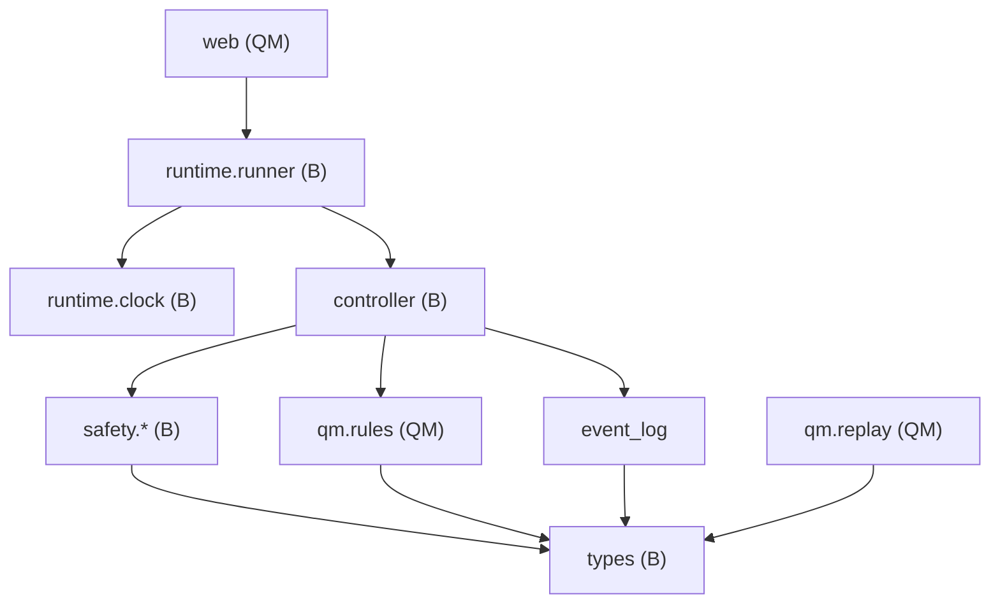
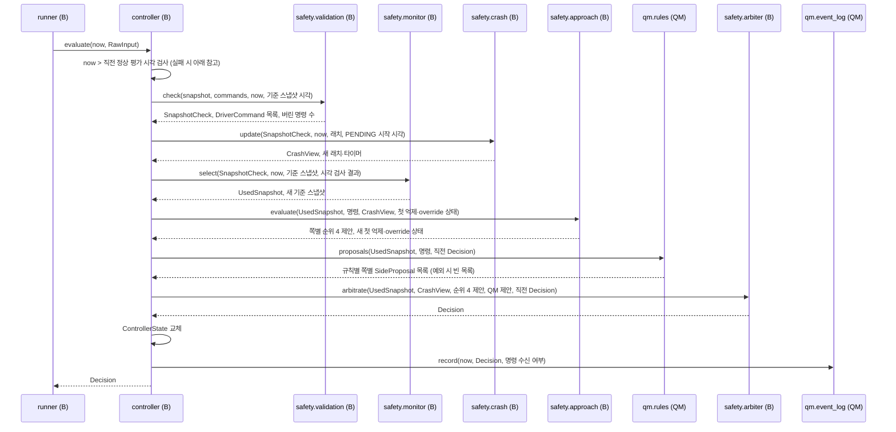

# SW 아키텍처 설계서 — 전자식 차일드락 제어 SW

| 항목 | 내용 |
|---|---|
| 문서 ID | SWE2-ARC |
| 개정 | 1.0 (독립 검토 SWE2-REV AR-01~23 반영) |
| 베이스라인 | BL-SWA-1.0 (G2 제출 대상) |
| 상위 입력 | SWE1-SRS 1.1 (BL-SWR-1.1) |
| A-SPICE | SWE.2 Software Architectural Design |
| ISO 26262-6 | Clause 7 (SW 아키텍처 설계), Annex D (간섭 배제) 중 프로젝트 선정 범위 |

## 1. 설계 목표와 제약

| ID | 목표 / 제약 | 출처 |
|---|---|---|
| G-1 | ASIL B 판단과 QM 판단을 패키지 단위로 분리하고, QM이 ASIL B 출력·상태·시간 판정을 바꾸지 못하게 한다 | SWE1-SRS P-1, P-2, DEC-05 |
| G-2 | 평가는 입력(스냅샷, 명령, 평가 시각)과 내부 상태만으로 결정되는 결정론적 계산이다 | SWR-016, SWR-022, DEC-04 |
| G-3 | 시각은 시각 공급원(`runtime.clock`)에서만 얻는다. 판단 코드는 시스템 시계를 읽지 않는다 | SWR-022 |
| G-4 | 실행 환경은 Python 3.12 단일 프로세스(PC/SIL). 하드웨어 메모리 보호가 없으므로 간섭 배제는 설계·코딩 규칙과 정적 검사로 확보한다 | OEM 3장 실행 환경 |
| G-5 | Web(FastAPI)은 QM이며 판단 로직, 시각, 내부 상태를 갖지 않는다. 입력 전달과 결과 조회만 한다 | SWR-014, 015, DEC-02 |

## 2. 정적 구조

### 2.1 패키지와 컴포넌트

```
src/child_lock/
├── types.py            [ASIL B] 공용 데이터 타입 (열거형, 불변 dataclass)
├── controller.py       [ASIL B] 평가 1회 조정, 내부 상태 보관
├── runtime/            [ASIL B]
│   ├── clock.py        시각 공급원 (실시간: time.monotonic / 시뮬레이션: 시험 벡터 시각)
│   └── runner.py       50 ms 주기 실행기, 입력 우편함, 직렬화
├── safety/             [ASIL B]
│   ├── validation.py   원시 입력 → 불변 타입, 신호별 형식·범위 검사, `all` 명령 분해
│   ├── monitor.py      기준 스냅샷, 쓰는 스냅샷 선택, 입력 지연 판정
│   ├── crash.py        충돌 래치, PENDING 타이머
│   ├── approach.py     접근위험, 첫 억제, override (좌·우 독립)
│   └── arbiter.py      제안 검사, 규칙 순위 판정, PENDING 필터, 이유코드, state
├── qm/                 [QM]
│   ├── rules.py        순위 6~10 규칙별 쪽별 제안
│   ├── event_log.py    제어결정 판정과 기록 (최근 100건, 메모리)
│   └── replay.py       공개 결과 해시
└── web/                [QM]
    ├── app.py          FastAPI 앱 (입력 전달, 상태·이벤트 조회)
    └── static/         시뮬레이터 화면
```

| 컴포넌트 | 등급 | 책임 | 주요 SWR |
|---|---|---|---|
| `types` | B | 입력·출력·내부 전달 데이터 타입 정의 (2.3절) | 전체 |
| `controller` | B | 한 평가의 순서 제어(3장). 상태(`ControllerState`)를 비공개로 보관하고 평가 후 교체. 평가 시각 단조 증가 검사 | SWR-019, 022 |
| `runtime.clock` | B | `Clock` 프로토콜. `MonotonicClock`(실시간)과 `ScriptedClock`(시험 벡터 시각) 두 구현. 시스템 시계를 읽는 유일한 곳. Web 앱은 항상 `MonotonicClock`으로 runner를 만든다. `ScriptedClock`은 시험 하니스(`tests/`, `tools`)만 만들고 시각을 넣는다 | SWR-022 |
| `runtime.runner` | B | 50 ms마다 clock에서 시각을 얻어 우편함의 입력으로 controller를 한 번 평가. `submit` 시점에 원시 입력을 `types.freeze_raw`로 깊은 불변 구조로 바꿔 우편함에 넣는다. 우편함 규칙은 SWR-022(스냅샷은 `CONFIRMED` 우선 후 최신 1개, 명령은 순서대로 누적, 버린 스냅샷 수 기록). 모든 진입(`submit`, `tick`, `status`, `events`)을 락 하나로 직렬화. 주기 대기는 `threading.Event.wait`, 마감 시각 계산은 clock으로 한다. 주기 초과 처리 | SWR-022 |
| `safety.validation` | B | 원시 입력을 신호별로 검사해 `SnapshotCheck`와 `DriverCommand` 목록을 만든다. `all`을 좌·우 두 명령으로 분해 | SWR-002, 013 |
| `safety.monitor` | B | 기준 스냅샷 보관, 쓰는 스냅샷 선택, 0.200초 지연 판정, `input_validity` 산출 | SWR-013, 022 |
| `safety.crash` | B | 래치 설정·해제(SWR-007), PENDING 타이머(SWR-008) | SWR-007, 008 |
| `safety.approach` | B | 쪽별 접근위험 잠금, 첫 억제 기록, override 성립·종료 | SWR-005, 006, 009 |
| `safety.arbiter` | B | QM 제안 검사(2.4절), 순위 1~11 판정, PENDING 필터, 쪽별 이유, `reason_code`, `state`, `warning_code` | SWR-008, 013, 019, 021 |
| `qm.rules` | QM | 순위 6~10 **규칙마다** 쪽별 제안을 계산해 모두 반환. 순위 판정은 하지 않음 | SWR-001~004, 017, 018, 020 |
| `qm.event_log` | QM | 제어결정 판정과 기록, 최근 100건 조회 | SWR-010, 011, 012 |
| `qm.replay` | QM | `Decision` 목록의 SHA-256 해시. 시험 하니스(SWE.5/6)와 `tools`가 호출 | SWR-016 |
| `web.app` | QM | HTTP 인터페이스. `runner`의 공개 메서드(`submit`, `status`, `events`)만 호출. JSON 구문 오류만 422, 직렬화 실패 500. 시각을 만들거나 넘기지 않는다 | SWR-014, 015 |

### 2.2 의존 규칙



DR-1~DR-4, DR-8은 패키지 내부(`child_lock.*`) import에 대한 규칙이다. 외부 import는 아래 허용 목록으로 따로 정한다.

| 규칙 | 내용 |
|---|---|
| DR-1 | `safety.*`는 패키지 내부에서 `types`만 import한다 |
| DR-2 | `qm.*`는 패키지 내부에서 `types`만 import한다 |
| DR-3 | `types`는 패키지 내부 모듈을 import하지 않는다 |
| DR-4 | `web.*`는 패키지 내부에서 `runtime.runner`, `runtime.clock`(앱 생성 시 `MonotonicClock`), `types`만 import한다 |
| DR-5 | `runtime.*`을 뺀 모든 패키지 모듈은 아래 금지 목록을 import·호출하지 않는다: 모듈 `time`, `random`, `secrets`, `os`, `io`, `socket`, `pathlib`, `importlib`, `threading`, `subprocess`, `asyncio`(web 제외); 호출 `datetime.now`, `datetime.today`, `datetime.utcnow`, `open`, `__import__`, `exec`, `eval`, `compile`. `runtime.runner`는 `threading`만, `runtime.clock`은 `time`만 예외로 쓴다 |
| DR-8 | `controller`는 패키지 내부에서 `types`, `safety.*`, `qm.rules`, `qm.event_log`만 import한다. `runtime.runner`는 `controller`, `runtime.clock`, `types`, `qm.event_log`(기본 구성 생성과 이벤트 조회용)만 import한다 |

**외부 import 허용 목록**

| 대상 | 허용 |
|---|---|
| 전체 | `__future__`, `dataclasses`, `enum`, `typing`, `math`, `collections`, `types`(MappingProxyType), `itertools`, `functools` |
| `qm.replay` | 위 + `hashlib`, `json` |
| `runtime.*` | 위 + DR-5 예외 |
| `web.*` | 위 + `fastapi`, `pydantic`, `starlette`, `json`, `logging`, `asyncio`, `pathlib`(정적 파일 위치) |
| DR-6 | `qm.*`, `web.*`는 다른 모듈 객체의 `_`로 시작하는 속성에 접근하지 않고, `setattr`, `object.__setattr__`, `__dict__`를 쓰지 않는다 |
| DR-7 | `types`의 dataclass는 모두 `frozen=True`, `slots=True`이고 필드 타입은 불변 타입(`int`, `float`, `str`, `bool`, Enum, `tuple`, `frozenset`, 다른 불변 dataclass, `None`)만 쓴다 |

검사 방법은 정적분석 계획(SWE2-SAP) SA-7~SA-11.

### 2.3 인터페이스 (데이터 타입)

| 타입 | 필드 | 생산 → 소비 |
|---|---|---|
| `RawInput` | `snapshot: FrozenValue \| None`, `commands: tuple[FrozenValue, ...]`, `dropped_snapshots: int`. `FrozenValue`는 원시 JSON 값을 `types.freeze_raw`로 바꾼 깊은 불변 구조(dict → 키 정렬 `tuple[tuple[str, FrozenValue], ...]`를 감싼 불변 dataclass, list → `tuple`, 스칼라는 그대로). 내용은 아직 검증 전이다 | runner(`submit` 시 변환) → 우편함 → controller |
| `SnapshotCheck` | `received: bool`, 신호별 값(오류 신호는 `None`), `asil_b_errors: frozenset[str]`, `qm_errors: frozenset[str]`, `crash_status_valid: bool`, `timestamp_valid: bool` | validation → monitor, crash |
| `UsedSnapshot` | 판정에 쓰는 신호 값 전체, `source_timestamp_s`, `qm_errors`, `input_validity`, `rank2: bool` | monitor → approach, rules, arbiter |
| `DriverCommand` | `side: Side`(`LEFT`/`RIGHT`, `all`은 분해됨), `action: Action`, `source: Source` | validation → approach, rules |
| `CrashView` | `latched: bool`, `pending_filter: bool` | crash → approach, arbiter |
| `SideProposal` | `rank: int`, `output: LockOutput \| None`(None = 유지), `reason: ReasonCode` | approach(순위 4), rules(순위 6~10) → arbiter |
| `Decision` | `lock_left`, `lock_right`, `state`, `priority_reason`, `reason_code`, `reason_left`, `reason_right`, `input_validity`, `warning_code` | arbiter → controller → runner → web, event_log, replay |
| `ControllerState` | 직전 `Decision`, 직전 평가 시각, 기준 스냅샷, 래치, PENDING 시작 시각, 쪽별 첫 억제 시각, 쪽별 override | controller 비공개 |
| `EventRecord` | `event_id`, `timestamp_s`, `Decision`의 9개 필드 | event_log → web |

**`SnapshotCheck` 의미**

| 경우 | `received` | 오류 집합 |
|---|---|---|
| 그 주기에 스냅샷 없음 | `false` | 비어 있음 |
| 스냅샷이 Mapping이 아님 | `true` | 모든 신호가 `asil_b_errors`/`qm_errors`에 들어감 |
| 정상 수신 | `true` | 신호별 검사 결과 |

**monitor의 쓰는 스냅샷 선택**

| 조건 | 쓰는 스냅샷 | 기준 스냅샷 갱신 | 결과 |
|---|---|---|---|
| 새 스냅샷, ASIL B 오류 없음 | 새 스냅샷 (QM 오류 신호는 `None`) | 새 스냅샷으로 갱신 | QM 오류 있으면 순위 5 |
| 새 스냅샷, ASIL B 오류 있음 | 기준 스냅샷 | 갱신 안 함 | 순위 2 `INVALID` |
| 스냅샷 없음 | 기준 스냅샷 | 갱신 안 함 | 기준 스냅샷의 QM 오류가 있으면 순위 5 |
| 평가 시각 − 기준 스냅샷 시각 > 0.200초, 또는 기준 스냅샷 없음 | 기준 스냅샷(없으면 판정 안 함) | — | 순위 2 `STALE` |
| 평가 시각이 직전 평가 시각 이하 (controller 검사) | — | 갱신 안 함 | 순위 2 `INVALID` |

열거형: `LockOutput`, `State`, `ReasonCode`, `InputValidity`, `WarningCode`, `Side`, `Action`, `Source`, `CrashStatus`, `Gear`.

### 2.4 간섭 배제 (ISO 26262-6 Annex D, 프로젝트 선정 범위)

단일 Python 프로세스라 메모리·실행 시간 간섭을 하드웨어로 막을 수 없다. 아래 수단으로 QM → ASIL B 간섭 경로를 막는다.

| 간섭 유형 | 경로 | 대응 |
|---|---|---|
| 데이터 손상 | QM이 ASIL B 상태를 직접 바꿈 | `ControllerState`는 controller 비공개, 불변 타입. QM은 `safety`·`controller`·`runtime`을 import할 수 없음(DR-2, DR-4). web은 runner 공개 메서드만 호출. 밑줄 속성 접근·`setattr` 금지(DR-6). 전달 타입은 깊은 불변(DR-7) |
| 데이터 손상 | 원시 입력(dict, list)을 web이 나중에 바꿔 ASIL B 판정에 영향 | runner가 `submit` 시점(락 안)에 깊은 불변 구조로 변환. 우편함과 그 뒤에는 원시 객체를 참조하지 않음 |
| 잘못된 값 전달 | QM 제안이 순위를 무시하거나 이유와 출력이 맞지 않음 | arbiter가 제안을 검사: 타입이 `SideProposal`인지, `rank`가 6~10인지, 이유코드와 순위가 맞는지, 출력 방향이 이유에 허용되는지(6·7은 `RELEASE`, 8·9는 `LOCK`, 10은 둘 다). 하나라도 어긋나면 그 제안을 버림. PENDING 필터는 QM 제안의 `RELEASE`→`LOCK` 전환 전부에 적용 |
| 잘못된 값 전달 | QM 제안이 순위 1~5가 정한 쪽을 바꿈 | arbiter가 순위 1~5를 먼저 판정하고, 정해지지 않은 쪽에만 QM 제안을 반영 |
| 예외 전파 | QM 규칙·이벤트 기록 중 예외 | controller가 QM 호출을 감싸 예외 시 QM 제안 없음(직전 유지)으로 처리하고 ASIL B 판정은 계속. 이벤트 기록 실패는 판정 결과에 영향 없음 |
| 시각 | QM이 평가 시각을 만들어 시간 판정을 왜곡 | 시각은 `runtime.clock`(ASIL B)만 공급. Web 앱은 항상 `MonotonicClock`을 쓰고 시각을 넘기지 않는다. `ScriptedClock`은 시험 하니스만 만든다(SA-7로 web에서 `ScriptedClock` 사용 금지 확인). controller가 시각 단조 증가를 검사하고, 실패 시 상태 갱신을 건너뛴다(SWR-022) |
| 실행 순서 | 동시 요청으로 상태 교체·이벤트 기록 경쟁 | runner가 모든 진입(`submit`, `tick`, `status`, `events`)을 하나의 락으로 직렬화. web 엔드포인트는 `async def`로 runner만 호출 |
| 실행 시간 | 평가가 주기를 넘김 | 평가는 I/O 없는 계산. 목표 5 ms 이하(7장). 주기 초과 시 runner는 밀린 주기를 따라잡지 않고 다음 주기 하나만 바로 실행하며 초과 횟수를 센다 |
| 공유 자원 | 모듈 전역 변경 가능 상태 | 모듈 최상위 대입은 허용 형태만(SWE2-SAP SA-10) |

## 3. 동적 구조 — 평가 1회



- 순서는 고정이다. 각 단계는 앞 단계 결과와 직전 `ControllerState`만 쓴다.
- 시각 검사에 실패하면 validation의 시간 검사, crash, monitor, approach 갱신을 하지 않는다. arbiter는 래치가 있으면 순위 1, 없으면 순위 2(`INPUT_INVALID`)로 판정하고, `ControllerState`는 직전 `Decision`만 교체한다(SWR-022, AR-25).
- crash는 monitor보다 먼저, **현재 수신 스냅샷**의 `crash_status`와 타임스탬프로 판정한다. 다른 신호 오류나 지연과 무관하다(SWR-007, AR-05).
- approach는 `UsedSnapshot.rank2`이거나 sensor fault이거나 래치이면 첫 억제·override 상태를 바꾸지 않고 명령을 세지 않는다. 다만 종료 조건(위험 해소, 3.0 km/h, 시동 OFF, 래치)은 판정해 override와 첫 억제를 지운다(SWR-006, AR-07).
- 명령 수신 여부에는 형식 오류로 버린 명령도 포함한다(SWR-010, AR-21).

## 4. 내부 상태

`state`는 평가마다 SWE1-SRS 1.3절 성립 조건으로 새로 계산하는 출력값이며 별도로 보관하지 않는다.

| 내부 상태 | 소유 | 설정 | 갱신 / 해제 | 시계 |
|---|---|---|---|---|
| 직전 정상 평가 시각 | controller | 시각 검사를 통과한 평가 | 실패한 평가에서는 갱신하지 않음(복귀 기준) | 평가 시각 |
| 기준 스냅샷 | monitor | ASIL B 신호가 모두 유효한 새 스냅샷 | 다음 그런 스냅샷으로 교체 | 스냅샷 시각 |
| 충돌 래치 | crash | 현재 수신 스냅샷의 유효 `CONFIRMED`, 나이 ≤ 1.0초 | 새로 받은 스냅샷에서 `crash_status`·`ignition_on`·타임스탬프 유효, `ignition_on=false`, `CONFIRMED` 아님 | 나이 = 평가 시각 − 스냅샷 시각 |
| PENDING 시작 시각 | crash | 유효 `PENDING` 첫 수신 평가 | 유효 `NONE`/`CONFIRMED` 수신 시 지움. 스냅샷 없음·다른 신호 오류는 영향 없음 | 평가 시각 |
| 쪽별 첫 억제 시각 | approach | 위험 `true`, 그 쪽 `unlock`, 차속 < 3.0, 순위 1~3 아님, 첫 억제 없음 또는 10.0초 경과 | override 성립 시 지움. 종료 조건 시 지움 | 명령 시각(쓰는 스냅샷 시각) |
| 쪽별 override | approach | 첫 억제 이후 평가, 10.0초 이하, 같은 쪽 `unlock`, 차속 < 3.0, 순위 1~3 아님 | 종료 조건(위험 해소, 3.0 km/h, 시동 OFF, 래치) 시 지움 | 명령 시각 |
| 직전 Decision | controller | 매 평가 | — | — |

초기값: 출력 둘 다 `RELEASE`, 래치 없음, 기준 스냅샷 없음(첫 평가 `STALE`, A-15), 직전 평가 시각 없음.

## 5. 요구사항 할당 (SWR → 컴포넌트)

| SWR | ASIL | 컴포넌트 |
|---|---|---|
| SWR-001, 004 | QM | `qm.rules`, `safety.validation`(명령 검사) |
| SWR-002 | QM | `qm.rules`, `safety.validation`(`all` 분해) |
| SWR-003 | QM | `qm.rules` |
| SWR-005, 006, 009 | B | `safety.approach` |
| SWR-007 | B | `safety.crash`, `safety.arbiter` |
| SWR-008 | B | `safety.crash`(타이머), `safety.arbiter`(필터) |
| SWR-010, 011, 012 | QM | `qm.event_log` |
| SWR-013 | B | `safety.validation`, `safety.monitor`, `safety.arbiter`(순위 2, 5) |
| SWR-014 | QM | `web.app`, `types.Decision` |
| SWR-015 | QM | `web.app` |
| SWR-016 | QM | `qm.replay`, `controller`(결정론) |
| SWR-017, 018, 020 | QM | `qm.rules` |
| SWR-019 | B | `safety.arbiter` |
| SWR-021 | B | `safety.arbiter` |
| SWR-022 | B | `runtime.runner`, `runtime.clock`, `controller`, `safety.monitor` |

- 22개 SWR이 모두 하나 이상의 컴포넌트에 할당된다(22/22). 할당되지 않은 컴포넌트는 없다(`types`는 전체 SWR의 데이터 정의).
- ASIL B SWR은 ASIL B 컴포넌트에만 할당된다. 순위 판정(SWR-019)은 arbiter만 하고, `qm.rules`는 규칙별 제안만 낸다(AR-08).
- QM SWR(SWR-001, 002, 004)의 명령 검사·분해를 ASIL B 컴포넌트(`safety.validation`)가 맡는 것은 높은 등급으로 개발하는 것이므로 허용된다.

## 6. ISO 26262-6 Table 3 설계 원칙 적용

| 원칙 | 적용 |
|---|---|
| 계층 구조 | `web` → `runtime` → `controller` → `safety`/`qm` → `types` 단방향 |
| 컴포넌트 크기·복잡도 제한 | 함수 50줄, 순환 복잡도 10 이하 (자동 검사) |
| 인터페이스 크기 제한 | 컴포넌트 간 전달은 2.3절 타입으로만 |
| 높은 응집도 | 규칙 묶음별 모듈 (충돌, 접근위험, 입력) |
| 낮은 결합도 | QM과 ASIL B 사이 import 금지, 제안 반환 방식 |
| 적절한 스케줄링 | runner의 50 ms 주기 평가 1회, 고정 순서, 직렬화 |
| 인터럽트 사용 제한 | 해당 없음 (인터럽트 없음. 스레드는 runner의 주기 스레드 하나) |

## 7. 자원·타이밍 예산

| 항목 | 예산 | 확인 |
|---|---|---|
| 평가 1회 실행 시간 | 5 ms 이하 (50 ms 주기의 10%). 10,000회 평가의 최댓값으로 측정(GC 포함) | SWE.5 |
| 주기 초과 | 밀린 주기는 따라잡지 않음, 초과 횟수 기록 | SWE.5 |
| 메모리 | 이벤트 100건 + 상태 1개. 평가 수와 무관하게 일정 | SWE.5 (10,000회 평가 전후 비교) |
| 응답 시간 요구(300/200/100 ms) | 주기 50 ms로 만족 | SWE.6 |

## 8. 추적

- 상위: SWE1-SRS 1.1 SWR-001~022 → 5장 할당표.
- 하위: 상세 설계(SWE3)는 이 문서의 컴포넌트·타입·의존 규칙을 따른다.
